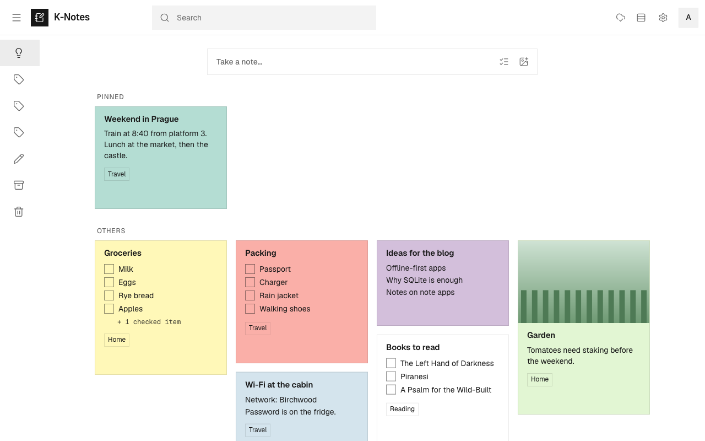
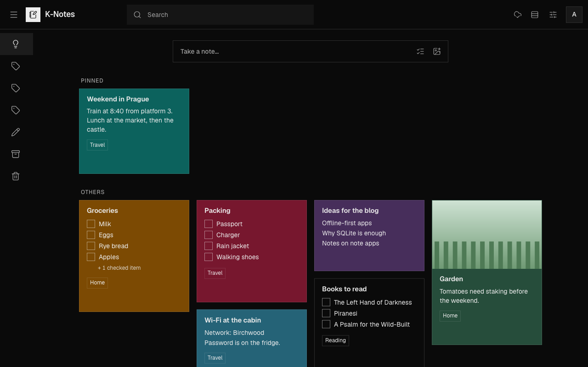
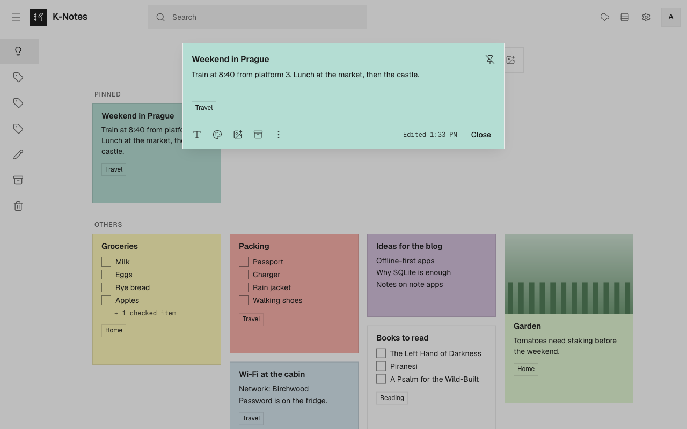
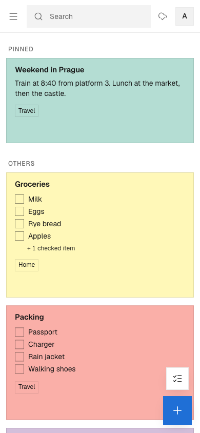

# K-Notes

Self-hosted notes with the layout and habits of Google Keep: quick notes, checklists, labels, colours and images. It installs on phones as a web app (PWA), works fully offline and syncs between devices within moments when online. One small server keeps everything in one directory, so a backup is a copy of that directory.



| Dark theme | Editing a note | On a phone |
| --- | --- | --- |
|  |  |  |

## Features

- Text notes with bold, italic, underline and two heading sizes; checklists with a section for checked items.
- Images on notes, resized on the device before upload.
- Labels, twelve note colours, pinning, archive, trash, and search that ignores case and accents.
- Grid and list view, drag to reorder, select several notes for bulk actions.
- Works offline: create, edit, reorder and delete without a connection; changes sync when it comes back. Edits of the same note on two offline devices never overwrite each other silently: the losing version is kept as a conflict copy.
- Several accounts, each with private notes: invite people by link, or open registration.
- Password login with optional two-step verification (TOTP), optional single sign-on through any OIDC provider.
- Personal API tokens and a small REST API for scripts.
- Light and dark theme.

Not included on purpose: sharing notes between users, reminders, drawings, e-mail of any kind, import and export.

Known limitation: notes and checklist items are reordered by dragging with a mouse or a finger only; there is no way to do it from the keyboard.

## Quick start

You need Docker with Compose, a domain name pointing at the machine, and a reverse proxy that provides HTTPS (see [HTTPS and the reverse proxy](#https-and-the-reverse-proxy)). Browsers only allow the offline app and installing it over HTTPS.

1. Get the example Compose file and create the data directory. The container runs as user 1000, so that user has to own it:

   ```sh
   mkdir k-notes && cd k-notes
   curl -fsSLO https://raw.githubusercontent.com/K-cermak/K-Notes/main/docker-compose.yml
   mkdir data && sudo chown 1000:1000 data
   ```

2. In `docker-compose.yml`, set `APP_BASE_URL` to the address people will use, such as `https://notes.example.com`. It must match exactly: the server uses it for links and to refuse requests from other sites.
3. Start it:

   ```sh
   docker compose up -d
   docker compose logs -f   # optional: watch it start
   ```

4. Set up the reverse proxy below, open the address in a browser and create the first account, which becomes the administrator.

To add people, open **Administration** from the account menu and create an invite link. The app sends no e-mail, so pass the link on yourself.

On a phone, open the address and use **Add to Home Screen** (Safari: Share → Add to Home Screen; Chrome: the install prompt or the menu). On iPhones this also matters for your data: Safari may delete the data of a website that has not been opened for seven days, but not of an app on the home screen.

### Updating

```sh
docker compose pull && docker compose up -d
```

Database migrations run by themselves when the new version starts. Open apps show "Update available" and load the new version when you choose Reload.

## Configuration

All settings are environment variables. Only `APP_BASE_URL` is required. The server checks them at startup and stops with a message naming the variable if one is wrong.

| Variable | Default | Meaning |
| --- | --- | --- |
| `APP_BASE_URL` | (required) | Public address, such as `https://notes.example.com`, with no path |
| `APP_DATA_DIR` | `/data` | Where the database, images and generated secret key live |
| `APP_SECRET_KEY` | generated | At least 32 characters. If unset, one is generated on first start and kept in `APP_DATA_DIR/secret.key`. Changing it signs out OIDC logins in progress and makes two-step verification secrets unreadable |
| `APP_TRASH_RETENTION_DAYS` | `7` | Days before notes in the trash are deleted for good; `0` keeps them until emptied by hand |
| `APP_MAX_IMAGE_MB` | `10` | Largest image accepted, after the device has resized it |
| `APP_SESSION_DAYS` | `180` | How long a sign-in lasts without use. Long on purpose: an offline app should not sign people out |
| `APP_PASSWORD_LOGIN_ENABLED` | `true` | `false` allows sign-in only through OIDC, which must then be configured |
| `APP_OIDC_DISCOVERY_URL` | | The provider's `.well-known/openid-configuration` URL |
| `APP_OIDC_CLIENT_ID` | | |
| `APP_OIDC_CLIENT_SECRET` | | OIDC is on when all three OIDC variables are set |
| `APP_OIDC_PROVIDER_NAME` | `SSO` | Label of the sign-in button |
| `APP_OIDC_AUTO_PROVISION` | `false` | Create accounts for people the provider knows but the app does not |
| `APP_TRUSTED_PROXIES` | | Comma-separated addresses or networks of reverse proxies whose `X-Forwarded-For` is believed, for the client address in logs and sign-in throttling |
| `APP_LOG_LEVEL` | `info` | `debug`, `info`, `warning`, `error` or `critical` |

Storage limits per user and open registration are set by an administrator in the app, not here.

### Single sign-on (OIDC)

Register the app with your provider (Authentik, Keycloak, Authelia, Google, …) as a confidential client using the authorization code flow, with the redirect URI `https://notes.example.com/api/v1/auth/oidc/callback` (your `APP_BASE_URL` followed by `/api/v1/auth/oidc/callback`) and the scopes `openid email profile`. Then set the three OIDC variables.

Someone signing in through the provider is matched to an account in this order: an account already linked to them; an account with the same e-mail address, if the provider says the address is verified; a new account, if `APP_OIDC_AUTO_PROVISION` is on. Otherwise they are told to ask an administrator. Signed-in users can link and unlink the provider in their security settings.

## HTTPS and the reverse proxy

The container speaks plain HTTP on port 8000. Put a reverse proxy in front of it that handles HTTPS. Two things matter for the proxy:

- The live updates use Server-Sent Events on `/api/v1/sync/events`, a response that stays open. The proxy must not buffer it and must not close it early.
- Request bodies up to the image limit (10 MB by default) must get through, and a sync request can carry up to about 1 MB of notes.

Run exactly one container. Live updates are passed around inside the server process and SQLite has a single writer, so several copies behind a load balancer would not see each other's changes.

### Caddy

Caddy gets a certificate by itself and passes event streams through unbuffered:

```caddy
notes.example.com {
	reverse_proxy 127.0.0.1:8000
}
```

### nginx

```nginx
server {
    listen 443 ssl;
    http2 on;
    server_name notes.example.com;

    ssl_certificate     /etc/letsencrypt/live/notes.example.com/fullchain.pem;
    ssl_certificate_key /etc/letsencrypt/live/notes.example.com/privkey.pem;

    # Above APP_MAX_IMAGE_MB.
    client_max_body_size 20m;

    location / {
        proxy_pass http://127.0.0.1:8000;
        proxy_set_header Host $host;
        proxy_set_header X-Forwarded-For $proxy_add_x_forwarded_for;
        proxy_set_header X-Forwarded-Proto $scheme;
    }

    # The live update stream: unbuffered and long-lived.
    location /api/v1/sync/events {
        proxy_pass http://127.0.0.1:8000;
        proxy_set_header Host $host;
        proxy_set_header X-Forwarded-For $proxy_add_x_forwarded_for;
        proxy_http_version 1.1;
        proxy_set_header Connection "";
        proxy_buffering off;
        proxy_read_timeout 1h;
    }
}
```

If the proxy runs in Docker too, point it at the container by its service name instead of `127.0.0.1`, and remove the `ports` section from the Compose file.

## Backup and restore

Everything lives in the data directory: the SQLite database, the images and the generated secret key.

```sh
docker compose stop
cp -a data "backup-$(date +%F)"
docker compose start
```

Stop the container first, so the database is not copied halfway through a write. To restore, stop the container, replace `data` with the backup and start it again. What changed after the backup was taken is gone, on the devices too: they notice that the server is behind them and load its state again.

## Administration from the command line

For a locked-out administrator, or when no one else can help:

```sh
docker compose exec notes python -m app.cli reset-password someone@example.com   # prints a one-time reset link
docker compose exec notes python -m app.cli disable-totp someone@example.com     # turns off two-step verification
docker compose exec notes python -m app.cli make-admin someone@example.com       # grants admin rights
```

## REST API

Create a token under Settings → API tokens, choosing read or read and write access. The token works only for notes and labels, never for account, security or admin settings.

```sh
curl -H "Authorization: Bearer $TOKEN" https://notes.example.com/api/v1/notes
curl -H "Authorization: Bearer $TOKEN" -H "Content-Type: application/json" \
     -d '{"title": "Milk", "items": ["2 litres", "oat"], "labels": ["Shopping"]}' \
     https://notes.example.com/api/v1/notes
```

The full reference is at `/api/v1/docs` on your instance.

## Adding a translation

1. Copy `frontend/src/locales/en.json` to `frontend/src/locales/<code>.json`, for example `de.json`, and translate the values. Keep the keys.
2. Add the language to `LOCALES` in `frontend/src/i18n.ts`, under the same code, with its name in that language: `{ en: 'English', de: 'Deutsch' }`.

People can then pick it under Settings → Profile.

## Development

You need Python 3.14 with [uv](https://docs.astral.sh/uv/), Node 26 with pnpm 12, [just](https://just.systems/) and Docker.

```sh
just setup                                       # install dependencies of both sides
cd frontend && pnpm exec playwright install chromium && cd ..   # once, for end-to-end tests
just dev                                         # backend on :8000 and Vite on http://localhost:5173
```

Open http://localhost:5173 exactly: `127.0.0.1` is a different address to the browser, and the server refuses changes from it. `just dev` keeps its data in `backend/.data`. Other recipes:

| Command | |
| --- | --- |
| `just check` | Lint, type checks and unit tests of both sides, as CI runs them |
| `just fmt` | Format both sides |
| `just test-e2e` | Build the image and run the Playwright tests against it |
| `just api-types` | Regenerate the frontend's API types after changing the API |
| `just docker` | Build the image |
| `just screenshots` | Render the screenshots in this README from the built image |

How it is built and why is described in [docs/SPEC.md](docs/SPEC.md). See [CONTRIBUTING.md](CONTRIBUTING.md) before sending changes.

## License

MIT, see [LICENSE](LICENSE).
